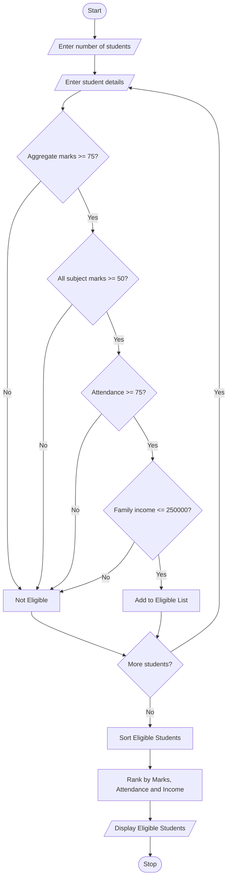

# University Scholarship Allocation System Using Python

## 1. Problem Statement

The University Scholarship Allocation System is designed to evaluate students based on their academic performance and eligibility criteria.

The system considers the following factors:

1. Aggregate Marks: Student must score at least 75% aggregate marks.
2. Subject-wise Minimum Scores: Student must score at least 50 marks in each subject.
3. Attendance: Student must have at least 75% attendance.
4. Family Income: Annual family income must not exceed ₹2,50,000.

The system identifies eligible students, ranks them based on aggregate marks, and resolves ties using attendance and family income.

## 2. Algorithm

1. Start the program.
2. Read the number of students.
3. Enter each student's name, aggregate marks, subject marks, attendance, and family income.
4. Check aggregate marks (minimum 75%).
5. Check subject-wise marks (minimum 50 in each subject).
6. Check attendance (minimum 75%).
7. Check annual family income (maximum ₹2,50,000).
8. If all conditions are satisfied, declare the student eligible.
9. Store all eligible students.
10. Sort eligible students based on:

- Highest aggregate marks.
- Highest attendance.
- Lowest family income.

11. Display the ranked list of eligible students.
12. Stop the program.

## 3. Flowchart 



## 5. Sample Input

```
Enter number of students: 3

Enter details of Student 1
Enter student name: Ravi
Enter aggregate marks: 85
Enter number of subjects: 3
Enter subject marks: 80
Enter subject marks: 90
Enter subject marks: 85
Enter attendance percentage: 90
Enter annual family income: 200000

Enter details of Student 2
Enter student name: Priya
Enter aggregate marks: 92
Enter number of subjects: 3
Enter subject marks: 90
Enter subject marks: 95
Enter subject marks: 91
Enter attendance percentage: 85
Enter annual family income: 180000

Enter details of Student 3
Enter student name: Kiran
Enter aggregate marks: 70
Enter number of subjects: 3
Enter subject marks: 75
Enter subject marks: 80
Enter subject marks: 70
Enter attendance percentage: 80
Enter annual family income: 150000
```

## 6. Sample Output

```
Eligible

Eligible

Not Eligible

--- SCHOLARSHIP RANK LIST ---

1 Priya 92.0 85.0 180000.0
2 Ravi 85.0 90.0 200000.0
```

