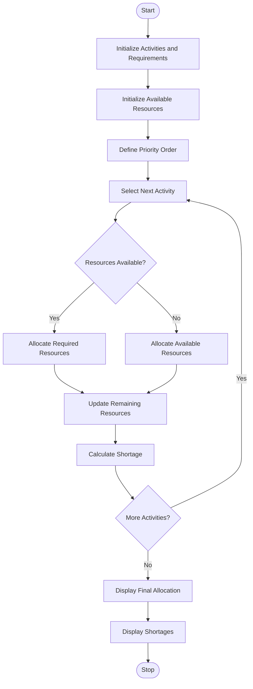

# Campus Resource Allocation Under Constraints – Python Program

## 1. Problem Statement

Write a Python program to compare equipment requirements with available resources across multiple campus activities. Calculate resource shortages and allocate available equipment according to a specified priority order. Display the final allocation and identify activities with insufficient resources.

## 2. Algorithm

1. Start the program.
2. Initialize campus activities and equipment requirements.
3. Store the available resources in a list.
4. Define the priority order of activities.
5. Calculate the total equipment requirements.
6. Compare available resources with required resources.
7. Allocate resources according to the priority order.
8. Calculate shortages for each activity.
9. Display the final allocation and shortages.
10. Stop the program.

## 3. Flowchart 


## 5. Sample Input

```
Activities:
Seminar = 10
Workshop = 15
Sports = 12

Available Resources = 25

Priority Order:
1. Workshop
2. Seminar
3. Sports
```

## 6. Sample Output

```
Campus Resource Allocation

Activity: Seminar
Required: 10
Allocated: 10
Shortage: 0

Activity: Workshop
Required: 15
Allocated: 15
Shortage: 0

Activity: Sports
Required: 12
Allocated: 0
Shortage: 12

Remaining Resources: 0
```

