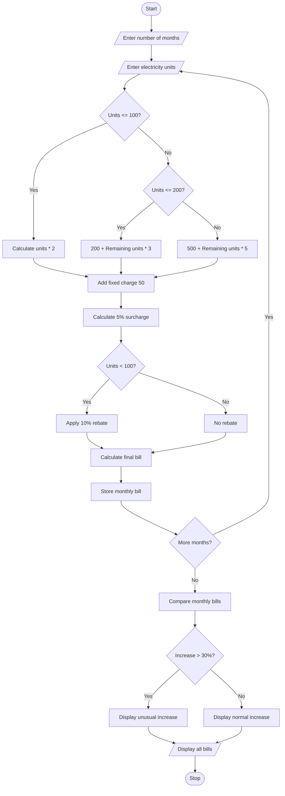

# Progressive Electricity Billing System Using Python

## 1. Problem Statement

The Progressive Electricity Billing System is designed to calculate household electricity bills based on monthly electricity consumption.

The system calculates the bill using multiple consumption slabs, fixed charges, surcharges, and rebates. It also compares electricity bills across several months and identifies unusual increases in billing amounts.

The system follows these conditions:

- 0–100 units: ₹2 per unit
- 101–200 units: ₹3 per unit
- Above 200 units: ₹5 per unit
- Fixed charge: ₹50
- Surcharge: 5% of energy charges
- Rebate: 10% if consumption is below 100 units.
- Unusual Increase: If the current bill increases by more than 30% compared to the previous month.

## 2. Algorithm

1. Start the program.
2. Enter the number of months.
3. Enter electricity units consumed for each month.
4. Calculate energy charges using progressive slabs.
5. Add fixed charges.
6. Calculate a 5% surcharge.
7. Apply a 10% rebate if consumption is below 100 units.
8. Calculate the final electricity bill.
9. Store monthly bills.
10. Compare each month's bill with the previous month's bill.
11. If the increase is greater than 30%, display unusual increase.
12. Display monthly bills.
13. Stop the program.

## 3. Flowchart 



## 5. Sample Input

```
Enter number of months: 3

Month 1
Enter electricity units: 80

Month 2
Enter electricity units: 120

Month 3
Enter electricity units: 250
```

## 6. Sample Output

```
Month 1
Energy Charge: 160.0
Fixed Charge: 50
Surcharge: 8.0
Rebate: 21.8
Total Bill: 196.2

Month 2
Energy Charge: 260.0
Fixed Charge: 50
Surcharge: 13.0
Rebate: 0
Total Bill: 323.0

Month 3
Energy Charge: 650.0
Fixed Charge: 50
Surcharge: 32.5
Rebate: 0
Total Bill: 732.5

--- MONTHLY BILL COMPARISON ---

Month 1 Bill: 196.2

Month 2 Bill: 323.0
Unusual Increase: 64.63 %

Month 3 Bill: 732.5
Unusual Increase: 126.78 %
```

- Percentage calculation
- Conditional statements
