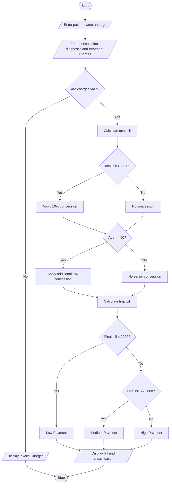

# Hospital Billing and Patient Classification System Using Python

## 1. Problem Statement

The Hospital Billing and Patient Classification System is designed to calculate the total hospital bill based on consultation charges, diagnostic charges, and treatment charges.

The system applies conditional concessions, validates billing constraints, and classifies patients according to their payment amount.

The system follows these conditions:

1. Consultation charge: ₹500
2. Diagnostic charge: ₹1,000
3. Treatment charge: ₹2,000
4. If the total bill is above ₹5,000, apply a 10% concession.
5. If the patient is a senior citizen (age 60 or above), apply an additional 5% concession.
6. Billing amount must not be negative.
7. Patient classification:
   - Below ₹2,000 – Low Payment
   - ₹2,000 to ₹5,000 – Medium Payment
   - Above ₹5,000 – High Payment

## 2. Algorithm

1. Start the program.
2. Enter patient name and age.
3. Enter consultation, diagnostic, and treatment charges.
4. Validate that charges are not negative.
5. Calculate the total bill.
6. If the total bill is above ₹5,000, apply a 10% concession.
7. If the patient age is 60 or above, apply an additional 5% concession.
8. Calculate the final bill.
9. Classify the patient based on the final payment amount.
10. Display patient details, concessions, and final bill.
11. Stop the program.

## 3. Flowchart 



## 5. Sample Input

```
HOSPITAL BILLING SYSTEM

Enter patient name: Ravi
Enter patient age: 65

Enter consultation charges: 1000
Enter diagnostic charges: 2000
Enter treatment charges: 4000
```

## 6. Sample Output

```
--- HOSPITAL BILL ---

Patient Name: Ravi
Patient Age: 65

Total Bill: 7000.0
Total Concession: 1050.0
Final Bill: 5950.0

Patient Classification: High Payment
```

