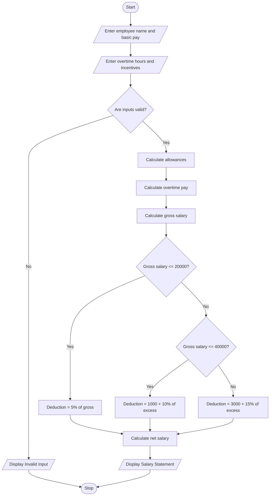

# Employee Payroll and Deduction Analysis Using Python

## 1. Problem Statement

The Employee Payroll and Deduction Analysis System is designed to calculate employee salaries based on basic pay, allowances, overtime, and incentives.

The system calculates gross salary, applies progressive deductions based on salary slabs, and generates a formatted salary statement showing gross salary, deductions, and net salary.

The system follows these conditions:

Salary Components:

- Basic Pay: Entered by the user.
- Allowances: 20% of basic pay.
- Overtime: Number of hours × ₹200.
- Incentives: Entered by the user.

Progressive Deductions:

- Salary up to ₹20,000 – 5% deduction.
- Salary from ₹20,001 to ₹40,000 – 10% deduction on the amount above ₹20,000.
- Salary above ₹40,000 – 15% deduction on the amount above ₹40,000.

Net Salary = Gross Salary − Total Deductions.

## 2. Algorithm

1. Start the program.
2. Enter employee name and basic pay.
3. Enter overtime hours and incentives.
4. Calculate allowances (20% of basic pay).
5. Calculate overtime pay (hours × ₹200).
6. Calculate gross salary by adding basic pay, allowances, overtime, and incentives.
7. Calculate progressive deductions:
   - First ₹20,000 at 5%.
   - Next ₹20,000 at 10%.
   - Remaining amount at 15%.
8. Calculate net salary.
9. Validate the entered values.
10. Display the formatted salary statement.
11. Stop the program.

## 3. Flowchart 

## 5. Sample Input

```
EMPLOYEE PAYROLL SYSTEM

Enter employee name: Ravi
Enter basic pay: 30000
Enter overtime hours: 10
Enter incentives: 2000
```

## 6. Sample Output

```
------ SALARY STATEMENT ------

Employee Name : Ravi
Basic Pay     : 30000.0
Allowances    : 6000.0
Overtime Pay  : 2000.0
Incentives    : 2000.0

------------------------------
Gross Salary  : 40000.0
Deductions    : 3000.0
Net Salary    : 37000.0
------------------------------
```

