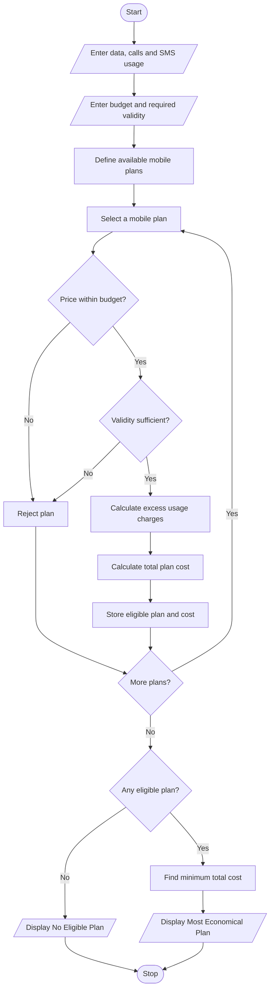

# Multi-Plan Telecommunications Cost Optimization Using Python

## 1. Problem Statement

The Multi-Plan Telecommunications Cost Optimization System is designed to compare different mobile recharge plans based on user requirements.

The system evaluates mobile plans using data usage, call minutes, SMS, validity, and budget constraints. It calculates excess charges when usage exceeds the plan limits and identifies the most economical eligible plan.

The system follows these conditions:


## 2. Algorithm

1. Start the program.
2. Enter the user's data usage.
3. Enter call minutes and SMS usage.
4. Enter the required validity and budget.
5. Define the available mobile plans.
6. Check whether each plan satisfies the validity requirement.
7. Check whether the plan price is within the budget.
8. Calculate excess data, call, and SMS charges.
9. Calculate the total cost of each eligible plan.
10. Compare the total costs of all eligible plans.
11. Select the most economical plan.
12. Display the plan details and total cost.
13. If no plan is eligible, display a message.
14. Stop the program.

## 3. Flowchart 


## 5. Sample Input

```
MOBILE PLAN COST OPTIMIZATION

Enter data usage in GB: 4
Enter call minutes: 150
Enter SMS usage: 120
Enter your budget: 500
Enter required validity in days: 28
```

## 6. Sample Output

```
--- PLAN COMPARISON ---

Plan A Total Cost: 409.0
Plan B Total Cost: 399.0
Plan C Total Cost: 449.0

--- BEST MOBILE PLAN ---

Plan Name: Plan B
Total Cost: 399.0
Extra Data Charge: 50.0
Extra Call Charge: 0
Extra SMS Charge: 0
```

