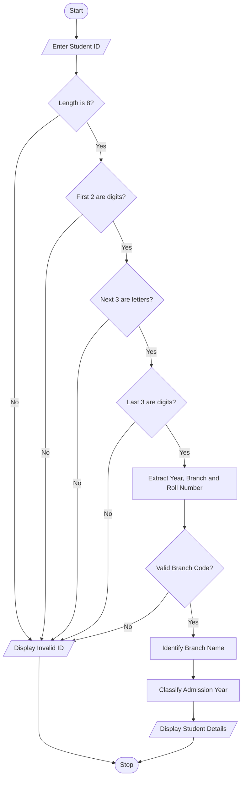

# Campus Registration Identifier Analyzer Using Python

## 1. Problem Statement

The Campus Registration Identifier Analyzer is designed to examine student identification numbers and validate their structure.

The system checks whether the student ID follows the correct format, extracts important components such as admission year, branch code, and student number, and classifies students according to their branch and admission year.

Student ID Format:

Example: `24CSE001`

- `24` – Admission year (2024)
- `CSE` – Branch code
- `001` – Student number

Branch Codes:

- CSE – Computer Science Engineering
- ECE – Electronics and Communication Engineering
- EEE – Electrical and Electronics Engineering
- MECH – Mechanical Engineering
- CIVIL – Civil Engineering

## 2. Algorithm

1. Start the program.
2. Enter the student registration ID.
3. Check whether the ID contains exactly 8 characters.
4. Check whether the first two characters are digits.
5. Check whether the next three characters are alphabets.
6. Check whether the last three characters are digits.
7. If the format is incorrect, display Invalid ID.
8. Otherwise, extract the admission year.
9. Extract the branch code.
10. Extract the student number.
11. Identify the branch name using the branch code.
12. Display the student details.
13. Stop the program.

## 3. Flowchart 


## 5. Sample Input

```
CAMPUS REGISTRATION ID ANALYZER

Enter Student ID: 24CSE001
```

## 6. Sample Output

```
--- STUDENT DETAILS ---

Student ID: 24CSE001
Admission Year: 2024
Branch Code: CSE
Branch Name: Computer Science Engineering
Student Number: 001
```

