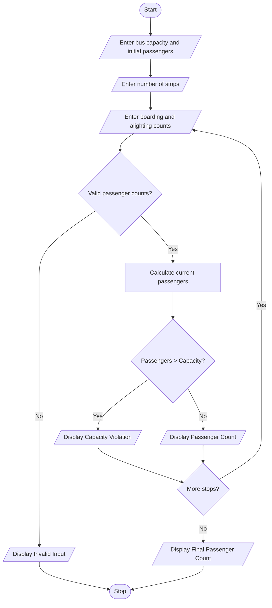

# Bus Passenger Occupancy Simulation Using Python

## 1. Problem Statement

The Bus Passenger Occupancy Simulation System is designed to track the number of passengers boarding and alighting at multiple bus stops.

The system calculates the total number of passengers after each stop and checks whether the bus exceeds its maximum seating capacity.

The system follows these conditions:

- Maximum bus capacity: 50 passengers.
- Boarding: Number of passengers entering the bus.
- Alighting: Number of passengers leaving the bus.
- Passenger count = Previous passengers + Boarding − Alighting.
- If passenger count exceeds 50, display Capacity Violation.
- If alighting passengers exceed the current passenger count, display Invalid Input.

## 2. Algorithm

1. Start the program.
2. Enter the maximum bus capacity.
3. Enter the initial number of passengers.
4. Enter the number of bus stops.
5. For each stop, enter boarding and alighting passengers.
6. Check whether the input values are valid.
7. Calculate the current passenger count.
8. Check whether passengers exceed bus capacity.
9. Display Capacity Violation if capacity is exceeded.
10. Display passenger count at each stop.
11. Repeat the process for all stops.
12. Display the final passenger count.
13. Stop the program.

## 3. Flowchart 


## 5. Sample Input

```
BUS PASSENGER OCCUPANCY SIMULATION

Enter bus capacity: 50
Enter initial passengers: 20
Enter number of stops: 3

Stop 1
Enter boarding passengers: 15
Enter alighting passengers: 5

Stop 2
Enter boarding passengers: 25
Enter alighting passengers: 5

Stop 3
Enter boarding passengers: 10
Enter alighting passengers: 0
```

## 6. Sample Output

```
BUS PASSENGER OCCUPANCY SIMULATION

Stop 1
Current Passengers: 30
Within Bus Capacity

Stop 2
Current Passengers: 50
Within Bus Capacity

Stop 3
Current Passengers: 60
CAPACITY VIOLATION!

--- FINAL BUS STATUS ---

Total Passengers: 60
Bus Capacity: 50
```

