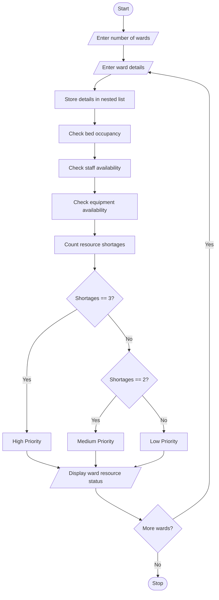

# Hospital Resource Allocation and Capacity Monitoring Using Python

## 1. Problem Statement

The Hospital Resource Allocation and Capacity Monitoring System is designed to monitor hospital resources across different wards using nested lists.

The system analyses bed occupancy, available medical staff, and equipment in each ward. It identifies resource shortages and prioritizes wards based on predefined rules.

The system follows these conditions:

1. Each ward contains bed occupancy, available staff, and equipment details.
2. If occupied beds are greater than or equal to total beds, display Bed Shortage.
3. If available staff are less than 3, display Staff Shortage.
4. If available equipment is less than 2, display Equipment Shortage.
5. If all three resources have shortages, assign High Priority.
6. If two resources have shortages, assign Medium Priority.
7. If one or no resources have shortages, assign Low Priority.

## 2. Algorithm

1. Start the program.
2. Enter the number of hospital wards.
3. Enter ward name and total beds.
4. Enter occupied beds, available staff, and equipment.
5. Store the details in a nested list.
6. Check bed availability.
7. Check staff availability.
8. Check equipment availability.
9. Identify resource shortages.
10. Calculate the priority level based on the number of shortages.
11. Display ward details and resource status.
12. Repeat for all wards.
13. Stop the program.

## 3. Flowchart


## 5. Sample Input

```
HOSPITAL RESOURCE ALLOCATION SYSTEM

Enter number of wards: 3

Enter Ward 1 Details
Enter ward name: Emergency
Enter total beds: 20
Enter occupied beds: 20
Enter available staff: 2
Enter available equipment: 1

Enter Ward 2 Details
Enter ward name: ICU
Enter total beds: 15
Enter occupied beds: 15
Enter available staff: 2
Enter available equipment: 3

Enter Ward 3 Details
Enter ward name: General
Enter total beds: 30
Enter occupied beds: 20
Enter available staff: 5
Enter available equipment: 4
```

## 6. Sample Output

```
--- RESOURCE ANALYSIS ---

Ward: Emergency
Bed Shortage
Staff Shortage
Equipment Shortage
Priority: High Priority

Ward: ICU
Bed Shortage
Staff Shortage
Equipment Available
Priority: Medium Priority

Ward: General
Beds Available: 10
Staff Available
Equipment Available
Priority: Low Priority

Resource Analysis Completed
```

