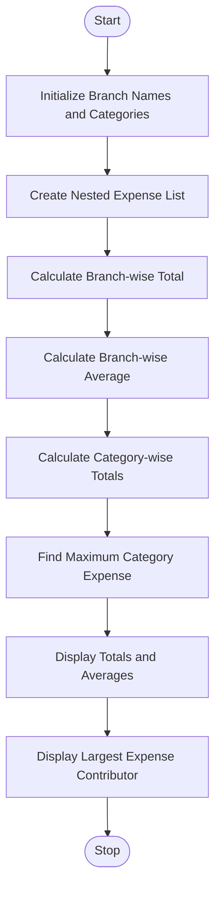

# Multi-Branch Expense Matrix Analysis

## 1. Problem Statement

Write a Python program to analyse nested lists containing monthly expenses of multiple branches across different categories. Calculate the total and average expenses for each branch, find the total expenses for each category, and identify the largest contributor to the overall expenditure.

## 2. Algorithm

1. Start the program.
2. Declare branch names and expense categories.
3. Create a nested list to store monthly expenses.
4. Calculate the total expenses for each branch using `sum()`.
5. Calculate the average expenses by dividing the total by the number of categories.
6. Calculate category-wise total expenses using nested loops.
7. Find the category with the highest expenditure using `max()`.
8. Display branch-wise totals, averages and largest expense contributor.
9. Stop the program.

##3. flowchart



## 5. Sample Input

```
Branch Names:
Vijayawada, Hyderabad, Chennai

Categories:
Rent, Salary, Transport

Monthly Expenses:

Vijayawada: 10000, 15000, 12000
Hyderabad: 18000, 20000, 15000
Chennai: 12000, 10000, 14000
```

## 6. Sample Output

```
Branch: Vijayawada
Total Expense: 37000
Average Expense: 12333.333333333334

Branch: Hyderabad
Total Expense: 53000
Average Expense: 17666.666666666668

Branch: Chennai
Total Expense: 36000
Average Expense: 12000.0

Category-wise Expenses:
Rent : 40000
Salary : 45000
Transport : 41000

Largest Expense Contributor: Salary
Highest Total: 45000
```

Result: The Python program successfully calculates branch-wise total and average expenses, category-wise expenditure, and identifies Salary as the largest contributor with ₹45,000.
